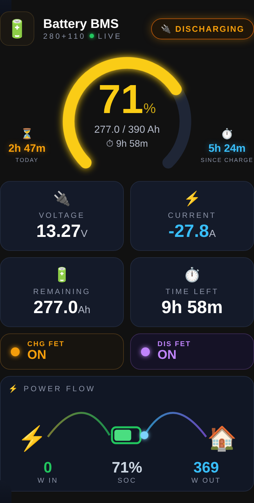

# JK Bank Card

Home Assistant card that shows **several JK BMS batteries connected in parallel as one bank**: combined SoC, current, remaining Ah, time left, FET status and a small power-flow view. Works with any BMS integration that exposes voltage / current / SoC sensors (BLE Battery Management, ESPHome JK-BMS, WiFi monitors…).

Картка для Home Assistant, що показує кілька паралельних JK BMS як один банк: сумарний SoC, струм, залишок Ah, час до розряду/заряду, стан FET і потік енергії.

<p align="center"></p>

## How values are combined

| Value | Formula |
|---|---|
| Current, power | sum of all batteries |
| Voltage | average |
| Remaining / capacity | sum (`remaining` falls back to `capacity × soc`) |
| SoC | Σ remaining / Σ capacity |
| Time left | remaining / \|I\| when discharging, (capacity − remaining) / I when charging |
| CHG / DIS FET | ON only if ON on every battery |

## Installation

### HACS (custom repository)
1. HACS → ⋮ → **Custom repositories** → `https://github.com/Rsa76d/jk-bank-card`, type **Dashboard**.
2. Install **JK Bank Card**, reload the browser (Ctrl+Shift+R).

### Manual
Copy `jk-bank-card.js` to `/config/www/` and add a resource `/local/jk-bank-card.js` (JavaScript module).

## Configuration

```yaml
type: custom:jk-bank-card
title: Battery BMS
subtitle: 280+110
idle_current: 0.3          # A, |I| below this = IDLE (default 0.3)
batteries:
  - voltage: sensor.bms_280_voltage
    current: sensor.bms_280_current     # A, + charge / − discharge
    power: sensor.bms_280_power         # W (optional, else V × I)
    soc: sensor.bms_280_soc             # %
    remaining: sensor.bms_280_remaining_capacity   # Ah (optional)
    capacity: sensor.bms_280_design_capacity       # Ah (entity or number)
    chg_fet: binary_sensor.bms_280_charge_mosfet   # optional
    dis_fet: binary_sensor.bms_280_discharge_mosfet
  - voltage: sensor.bms_110_voltage
    current: sensor.bms_110_current
    soc: sensor.bms_110_soc
    capacity: 110
# optional side timers (sensor in hours, e.g. history_stats)
timer_left:
  entity: sensor.discharge_time_today
  label: Today
timer_right:
  entity: sensor.discharge_time_since_charge
  label: Since charge
```

### Side timers (optional)

The timers just display an hours sensor. Example: time discharging today with a `history_stats` helper on a binary sensor that is `on` while the bank current is below −2 A.

## Credits

Layout inspired by [nafanjka/BMS-HA-card](https://github.com/nafanjka/BMS-HA-card) (single-BMS card). This card is an independent implementation for parallel banks.

## License

MIT
